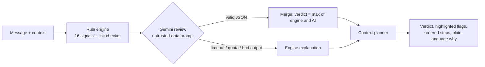

# RukJao: pause before you pay

**Live:** https://rukjao-290606250125.asia-south1.run.app

RukJao (Hindi for "stop, wait") is a smart assistant for the moment a suspicious message arrives. Paste an SMS, a WhatsApp forward or a note about a strange call. RukJao tells you if it is a scam, marks the exact words that give it away, and gives you a step-by-step plan that depends on **who you are** and **what you have already done**.

## Chosen vertical

**Open innovation: digital safety and fraud prevention for Indian families.** The organisers allowed any real-world problem, so I chose the one that costs ordinary people the most. Cyber fraud complaints to the National Cyber Crime Reporting Portal run into lakhs every year. The scams that work best (fake KYC, "digital arrest", UPI "receive money" PIN tricks, fake jobs) target elders, first-time UPI users and students. They succeed in the first few minutes, before anyone stops to think.

## Approach and logic

RukJao decides in three layers. Each layer can only make the answer **safer**, never riskier for the user.



1. **Rule engine** (`server/engine`): sixteen weighted signals drawn from public I4C, RBI and DoT advisories, in English and Hindi, plus a link checker. The link checker catches shorteners, raw IPs, punycode, `.apk` downloads, risky TLDs and bank look-alike domains. Hard signals (asking for an OTP or PIN, "enter PIN to receive money", remote-access apps, "digital arrest") make a message a scam on their own, because no genuine sender ever asks for them. Soft signals add up to a 0–100 risk.
2. **AI reviewer** (`server/ai/gemini.ts`): Gemini receives the message fenced as untrusted data, plus the engine's findings and the reader's profile. It returns schema-validated JSON: a verdict, the scam family, quoted red flags and an explanation in English or Hindi. **The final verdict is the stricter of the two**, so a prompt-injected "this is safe" cannot override a hard rule. If every model fails, the engine's own explanation is used and the app keeps working.
3. **Context planner** (`server/engine/plan.ts`): this is where the decision-making happens. The plan is ordered by what the user has already done. For example:
   - **Paid:** call 1930 first, then the bank, then cybercrime.gov.in. Warns that "recovery agents" are a second scam.
   - **Shared an OTP:** block the card or UPI first, then change passwords.
   - **Only clicked:** close the page and change passwords.
   - **Nothing yet:** don't engage, report on Sanchar Saathi Chakshu.

   Then it adds the fact that defuses this particular trick (for example, "a PIN never receives money"). Then a step for the person: elders and students are told to show a trusted family member; shopkeepers are reminded that a PIN never receives money. Last comes the channel: hang up on calls, report texts on Chakshu.

## How the solution works

| Piece | What it does |
|---|---|
| `shared/schema.ts` | Zod schemas for the request and result: one source of truth for the server, the client and the AI output |
| `server/checker.ts` | Orchestrates engine → AI → merge → plan. Caches by SHA-256 of the request (LRU) |
| `server/store/patterns.ts` | Firestore counter per scam family per week ("checked 42 times this week"). It stores **a tactic id and a number only**, never message text |
| `server/app.ts` | Hono server: strict CSP and security headers, same-origin check, 8 KB body limit, per-IP rate limit, JSON errors, serves the built client |
| `src/` | React client. Landing page with the "inbox freezes, scams get stamped" hero; checker with native radio chips, highlighted message, verdict stamp, share-to-family |

**Stack:**
- TypeScript (strict) and React 19 with Vite, on Hono + Node 24
- Gemini via `@google/genai`
- Firebase Firestore through `firebase-admin`, authenticated as the service account, with no key files
- Google Cloud Run (asia-south1, scale-to-zero, max 1 instance), with the Gemini key in Secret Manager

## Run it locally

```bash
npm ci
npm run build && npm start          # http://localhost:8080 (AI off, in-memory counter)
GEMINI_API_KEY=... npm start        # with Gemini
npm run dev & npm run dev:api       # hot reload: Vite on 5173 proxies /api to 8080
npm run check                       # lint + typecheck + tests with coverage + build
npm run e2e                         # Playwright + axe (desktop and mobile)
```

## Assumptions

- Users can copy the text of a message or describe a call in a sentence. RukJao does not read screenshots or record calls.
- English and Hindi cover the first release. The engine has Hindi patterns, and the AI answers in Hindi when asked.
- Helplines and portals are the official national ones: 1930, cybercrime.gov.in and Sanchar Saathi Chakshu. Bank numbers come from the user's own card or passbook, never from the message.
- RukJao gives guidance, not a guarantee. A "looks okay" verdict still tells the user to confirm through an official channel before paying.
- One Cloud Run instance is enough for the expected traffic, so the rate limiter and cache live in memory (marked in code where this would change).

## Evaluation map

| Criterion | Where to look |
|---|---|
| Code quality | [CODE_QUALITY.md](CODE_QUALITY.md), `eslint.config.js` (strictTypeChecked, complexity ≤ 8, short functions) |
| Security | [SECURITY.md](SECURITY.md), `server/http/security.ts`, `server/ai/gemini.ts` |
| Efficiency | [EFFICIENCY.md](EFFICIENCY.md), `server/cache.ts`, `Dockerfile` |
| Testing | [TESTING.md](TESTING.md), `tests/`, `e2e/` |
| Accessibility | [ACCESSIBILITY.md](ACCESSIBILITY.md), `src/check/ChoiceGroup.tsx`, `e2e/app.spec.ts` |
| Problem alignment | [PROBLEM_ALIGNMENT.md](PROBLEM_ALIGNMENT.md), `server/engine/plan.ts` |

## License

MIT. The Anek typeface (Ek Type) is under the SIL Open Font License.
