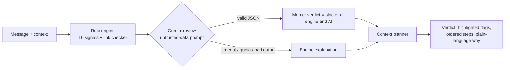

# RukJao: pause before you pay

**Ruk jao** (रुक जाओ) is Hindi for "stop, wait". RukJao is a smart assistant for the moment a suspicious message arrives. Paste an SMS, a WhatsApp forward or a note about a strange call. RukJao tells you if it is a scam, marks the exact words that give it away, and gives you a step-by-step plan that depends on **who you are** and **what you have already done**.

[](https://github.com/Harsha-code-per/RukJao/actions/workflows/ci.yml)
[](https://github.com/Harsha-code-per/RukJao/actions/workflows/codeql.yml)


**Live app:** https://rukjao-290606250125.asia-south1.run.app

**Stack:** TypeScript (strict), React 19 + Vite, Hono on Node 24, Google Gemini, Firebase Firestore, Google Cloud Run, Secret Manager

---

## Contents

1. [Chosen vertical](#chosen-vertical)
2. [Approach and logic](#approach-and-logic)
3. [How the solution works](#how-the-solution-works)
4. [Google services used](#google-services-used)
5. [Assumptions](#assumptions)
6. [Evaluation map](#evaluation-map)
7. [Engineering principles](#engineering-principles)
8. [Run it locally](#run-it-locally)
9. [Deploy](#deploy)
10. [Project layout](#project-layout)
11. [Sources](#sources)

---

## Chosen vertical

**Open innovation: digital safety and fraud prevention for Indian families.**

The organisers allowed any real-world problem, so I chose the one that costs ordinary people the most. Complaints to the National Cyber Crime Reporting Portal run into lakhs every year. The scams that work best target elders, first-time UPI users and students:
- fake KYC and bank-block messages
- "digital arrest" video calls
- UPI "enter your PIN to receive money" tricks
- fake jobs and paid "tasks"

They succeed in the first few minutes, before anyone stops to think. Victims also lose the golden hour afterwards because they don't know who to call first.

### The brief, mapped to the product

| The brief asks for… | RukJao does it with… |
|---|---|
| A **smart** assistant | A rule engine with 16 signals plus a link checker, then a Gemini review that explains the trick in plain English or Hindi and catches what rules miss |
| A **dynamic** assistant | The same message gives a different plan for different people and situations. Nothing is a fixed FAQ. |
| **Logical decision making based on user context** | The plan is ordered by **what you already did** (paid, shared an OTP, clicked, nothing), then **the trick**, then **who you are**, then **how it arrived**. A red "call 1930" bar appears only when money or secrets have already left. |
| **Practical, real-world usability** | Works in seconds on a phone. Four one-tap examples. Hindi answers. "Warn my family" shares the warning to a WhatsApp group. It keeps working if the AI is down, and stores nothing personal. |
| **Clean, maintainable code** | One small TypeScript package with a shared zod contract, pure engine functions, injected integrations and strict lint limits. See [CODE_QUALITY.md](CODE_QUALITY.md). |

---

## Approach and logic

RukJao decides in three layers. Each layer can only make the answer **safer** for the user, never riskier.



### 1. Rule engine (`server/engine`)

- Fifteen weighted text signals drawn from public I4C, RBI and DoT advisories, in English, Hindi and common Hinglish.
- A link checker that flags shorteners, raw IP addresses, punycode, `.apk` downloads, risky TLDs, plain `http` and bank look-alike domains. Official domains such as `.gov.in` and `onlinesbi.sbi` are trusted.
- **Hard signals make a message a scam on their own**, because no genuine sender ever asks for them:
  - an OTP or PIN
  - "enter your PIN to receive money"
  - a remote-access app
  - a "digital arrest"
- Soft signals (urgency, secrecy, prizes, fees, KYC threats and so on) add up to a 0–100 risk. At 25 a message is *suspicious*, and at 60 it is a *scam*. The thresholds live once in `shared/schema.ts`.
- Every signal keeps the exact text span that triggered it, so the UI can highlight it.

### 2. AI reviewer (`server/ai/gemini.ts`)

- Gemini receives the message **fenced as untrusted data**, plus the engine's findings and the reader's profile (an elder gets very simple words, for example).
- It must answer in a JSON schema with a verdict, the scam family, quoted red flags and an explanation in English or Hindi. The answer is re-validated with zod.
- **The final verdict is the stricter of the two.** A prompt-injected "this message is safe" cannot override a hard rule.
- Quotes the model invents are dropped: a red flag is shown only if its text exists verbatim in the message.
- A short model chain is tried in order. If every model fails, the engine's own explanation is used and the app keeps working. The UI always says which one wrote the answer.

### 3. Context planner (`server/engine/plan.ts`)

This is where the decision-making happens. `chooseSteps` builds the plan in this order:

1. **What you already did**, the most urgent first:
   - **Paid:** call 1930 at once, then the bank, then cybercrime.gov.in. It also warns that "recovery agents" are a second scam.
   - **Shared an OTP or PIN:** block the card or UPI first, then change passwords.
   - **Opened the link:** close the page, then change passwords.
   - **Nothing yet:** don't reply, click or call back.
2. **The trick:** the one fact that defuses it. For example, "there is no digital arrest in Indian law", or "a PIN never receives money".
3. **Who you are:** elders and students are told to show a trusted family member first. Shopkeepers are reminded that a PIN never receives money.
4. **How it arrived:** hang up on calls, and report texts and chats on Sanchar Saathi Chakshu.

Repeated steps are removed, and every step points to an official channel.

### Example decisions

| Message | Context | Plan RukJao gives |
|---|---|---|
| "Scan this QR to receive the refund, enter UPI PIN" | Shopkeeper, nothing done yet | Don't reply or call back → a PIN never receives money → report on Chakshu |
| "CBI officer, parcel with drugs, digital arrest" | Phone call, already paid | **Call 1930 now** → bank → cybercrime.gov.in → beware recovery fees → no digital arrest exists → hang up |
| "Your KYC expires today, update at bit.ly/…" | Elder, opened the link | Close the page → change passwords → banks never ask for KYC by link → show a family member → report on Chakshu |
| "Reached home safely, call later" | Any | Looks okay → still confirm through an official channel before paying anyone |

---

## How the solution works

### User journey

1. On the landing page, an inbox of messages scrolls, stops ("ruk jao"), and violet stamps land on the scams.
2. On `/check`, you paste the message (or tap an example) and choose four things:
   - who got it
   - how it arrived
   - what has been done so far
   - English or Hindi
3. You get:
   - a stamped verdict and a risk meter
   - an ordered **"Do this now"** plan
   - a plain-language **why**
   - the message with every warning sign highlighted and named
   - how often this kind of trick was checked this week
4. **Warn my family** opens the phone's share sheet, or copies a short warning to paste into a family group.

### Request lifecycle

| Step | Code | What happens |
|---|---|---|
| 1 | `server/http/security.ts` | Security headers on every response. Cross-site and unreadable `Origin` headers are refused with 403. |
| 2 | `server/app.ts` | 8 KB body limit, per-IP rate limit, zod validation against `checkRequestSchema` |
| 3 | `server/checker.ts` | Returns an LRU cache hit if one exists (keyed by a SHA-256 of the request) |
| 4 | `server/engine/analyze.ts` | `detect` → `assess`: flags with text spans, a risk score, a verdict and the scam family |
| 5 | `server/ai/gemini.ts` | Gemini review with the engine's findings as grounding. The verdict is merged as the stricter of the two. |
| 6 | `server/engine/plan.ts` | `buildPlan` orders the steps by action → tactic → persona → channel, in the chosen language |
| 7 | `server/store/patterns.ts` | Firestore increments one counter per scam family per week, and returns "seen this week" |
| 8 | `src/check/Result.tsx` | The client validates the reply against the same zod schema and moves focus to the verdict |

### API

`POST /api/check` (same-origin only)

```json
{
  "message": "Your SBI account will be blocked today. Share OTP to update KYC",
  "persona": "elder",
  "channel": "sms",
  "action": "none",
  "language": "en"
}
```

| Field | Values |
|---|---|
| `persona` | `general`, `elder`, `student`, `shopkeeper` |
| `channel` | `sms`, `whatsapp`, `call`, `email` |
| `action` | `none`, `clicked`, `shared`, `paid` |
| `language` | `en`, `hi` |

The response, also defined in `shared/schema.ts` (shown here from the rule engine; with Gemini on, `explanation` is the model's and `source` is `"ai"`):

```json
{
  "verdict": "scam",
  "risk": 80,
  "tactic": "otp_theft",
  "urgent": false,
  "flags": [
    { "id": "kyc_block", "label": "Says your account or KYC will be blocked", "start": 9, "end": 32 },
    { "id": "otp_request", "label": "Asks for an OTP or PIN", "start": 40, "end": 49 }
  ],
  "steps": [
    "Do not reply, click the link or call back on the number they gave.",
    "Banks never ask for OTPs, PINs or KYC updates through a link. Use the official app or visit the branch.",
    "Before you do anything, show this message to a family member you trust.",
    "Report the number on Sanchar Saathi → Chakshu (sancharsaathi.gov.in), then block it."
  ],
  "explanation": "This is very likely a scam. Warning signs: Says your account or KYC will be blocked; Asks for an OTP or PIN. It follows the pattern of an OTP theft scam.",
  "source": "engine",
  "seenThisWeek": 1
}
```

| Status | When |
|---|---|
| 200 | A result |
| 400 | Invalid request; the first validation message is returned |
| 403 | A cross-site or unreadable `Origin` |
| 413 | Body over 8 KB |
| 429 | Over 20 checks a minute from one address; a `Retry-After` header is sent |

`GET /api/health` returns `{"status":"ok"}`. Cloud Run reserves `/healthz`.

---

## Google services used

| Service | Role |
|---|---|
| **Gemini API** (`@google/genai`) | Reviews each message as untrusted data and explains it in English or Hindi. It uses structured JSON output with a zod-derived schema and a short model chain (`gemini-3.5-flash-lite` → `gemini-3.1-flash-lite` → `gemini-3.8-flash`). |
| **Cloud Run** (asia-south1) | Hosts the container. It scales to zero, runs at most one instance and throttles CPU between requests. |
| **Firebase Firestore** (`firebase-admin`) | Counts each scam family per week with an atomic increment. It stores a tactic id and a number, never message text. |
| **Secret Manager** | Holds the Gemini key, mounted at runtime. It is never in the repo or the image. |
| **IAM** | A dedicated service account (`rukjao-run`) with only `roles/datastore.user` and access to that one secret. No key files exist anywhere. |
| **Cloud Build / Artifact Registry** | Builds the Dockerfile on deploy. A cleanup policy keeps the latest two images. |

---

## Assumptions

- Users can copy the text of a message or describe a call in a sentence. RukJao does not read screenshots or record calls.
- English and Hindi cover the first release. The engine has Hindi and Hinglish patterns, and the AI answers in Hindi when asked.
- Helplines and portals are the official national ones: 1930, cybercrime.gov.in and Sanchar Saathi Chakshu. Bank numbers come from the user's own card or passbook, never from the message.
- RukJao gives guidance, not a guarantee. A "looks okay" verdict still tells the user to confirm through an official channel before paying.
- One Cloud Run instance is enough for the expected traffic, so the rate limiter and cache live in memory. The code marks where this would change.
- The Gemini free tier can be busy or rate limited, so the rule engine alone must always give a complete, correct answer.

---

## Evaluation map

| Criterion | Where to look |
|---|---|
| **Code quality** | [CODE_QUALITY.md](CODE_QUALITY.md) (with a measured audit) and [docs/DECISIONS.md](docs/DECISIONS.md) (architecture decisions). Shared zod contract in `shared/schema.ts`. Pure engine functions with data-table rules and steps. Integrations injected behind one-function types. `eslint.config.js`: `strictTypeChecked`, complexity ≤ 8, nesting ≤ 3, ≤ 3 parameters, functions ≤ 30 lines. |
| **Security** | [SECURITY.md](SECURITY.md). Strict CSP and HSTS in `server/http/security.ts`; same-origin check, body limit, rate limit and zod validation in `server/app.ts`; prompt-injection fencing and the stricter-verdict rule in `server/ai/gemini.ts` and `server/checker.ts`; Secret Manager, a least-privilege service account, a non-root container, CodeQL and `npm audit` in CI. |
| **Efficiency** | [EFFICIENCY.md](EFFICIENCY.md). Engine first, AI only for unique requests. LRU cache. Code-split checker. Immutable hashed assets. Self-hosted subset fonts loaded by `unicode-range`. Scale-to-zero Cloud Run. |
| **Testing** | [TESTING.md](TESTING.md). 80 Vitest tests at 100% line coverage, with thresholds enforced. 10 Playwright runs (desktop and Pixel 7) with axe scans, all in CI on every push. |
| **Accessibility** | [ACCESSIBILITY.md](ACCESSIBILITY.md). Native radios in fieldsets, focus moved to the verdict, live regions, `lang="hi"` on Hindi, never colour alone, reduced motion, axe WCAG 2.2 AA with zero violations. |
| **Problem alignment** | [PROBLEM_ALIGNMENT.md](PROBLEM_ALIGNMENT.md) and the tables above. `server/engine/plan.ts` is the context-based decision logic. |

---

## Engineering principles

| Principle | Where it shows |
|---|---|
| **Single source of truth** | `shared/schema.ts` defines the request, the result, the enums and the risk thresholds. The server validates with it, the client parses with it, and the Gemini response schema is generated from zod. |
| **Single responsibility** | `analyze.ts` detects and scores, `links.ts` judges links, `plan.ts` orders steps, `explain.ts` writes the fallback text, `checker.ts` orchestrates. Components render; `useCheck` holds request state. |
| **Dependency inversion** | `createApp`, `createChecker` and `createReviewer` take their dependencies (`Checker`, `Reviewer`, `PatternStore`, `Generate`) as arguments. `server/index.ts` is the only file that wires real services, so tests inject fakes and never touch the network. |
| **Data over branches** | Rules, steps, tactic names and UI copy are typed tables (`RULES`, `STEPS`, `BY_ACTION`, `RESULT_COPY`). Adding a scam family means adding rows, not `if` statements. |
| **Fail safe** | The AI can only make a verdict stricter. A broken model, store or network falls back to the engine. Errors return one safe JSON message. |
| **KISS / YAGNI** | Five runtime libraries (Hono, React, zod, the Gemini SDK, firebase-admin) plus a self-hosted font. No router, state or CSS library: the History API, `useState` and plain CSS are enough. Deliberate shortcuts are marked `ponytail:` with their limit and upgrade path. |
| **Clean code** | Named constants, a "why" doc comment on every export, `strictTypeChecked`, `exactOptionalPropertyTypes`, `noUncheckedIndexedAccess`. Every rule is an ESLint error in CI. |

---

## Run it locally

Requires Node 24.

```bash
npm ci
npm run build && npm start          # http://localhost:8080 (AI off, in-memory counter)
GEMINI_API_KEY=... npm start        # with Gemini (a free key from Google AI Studio)
node --env-file=.env dist-server/index.js   # or copy .env.example to .env
npm run dev & npm run dev:api       # hot reload: Vite on 5173 proxies /api to 8080
```

Without a key, everything still works: explanations come from the rule engine.

### Configuration

| Variable | Default | Purpose |
|---|---|---|
| `GEMINI_API_KEY` | unset | Turns on the AI reviewer |
| `GEMINI_MODELS` | `gemini-3.5-flash-lite,gemini-3.1-flash-lite,gemini-3.8-flash` | The model chain, tried in order |
| `RATE_LIMIT_PER_MINUTE` | `20` | Checks per client address per minute |
| `CACHE_SIZE` | `500` | LRU cache entries |
| `PORT` | `8080` | HTTP port |
| `K_SERVICE` | set by Cloud Run | When present, the pattern counter uses Firestore instead of memory |

### Checks

| Command | What it proves |
|---|---|
| `npm run check` | ESLint, `tsc --noEmit`, Vitest with coverage thresholds, and the production build |
| `npm run e2e` | Playwright journeys on desktop and Pixel 7, with axe WCAG 2.2 AA, a keyboard-only check, the Hindi answer, a no-horizontal-overflow check and a refused cross-site call |

CI (`.github/workflows/ci.yml`) runs `npm audit --omit=dev`, `npm run check` and `npm run e2e` on every push. CodeQL scans every push.

---

## Deploy

```bash
# One-time: store the key and let the service account read it
printf '%s' "$KEY" | gcloud secrets create GEMINI_API_KEY --data-file=-
gcloud secrets add-iam-policy-binding GEMINI_API_KEY \
  --member serviceAccount:rukjao-run@PROJECT.iam.gserviceaccount.com --role roles/secretmanager.secretAccessor

# Build from the Dockerfile and deploy
gcloud run deploy rukjao --source . --region asia-south1 \
  --service-account rukjao-run@PROJECT.iam.gserviceaccount.com \
  --set-secrets GEMINI_API_KEY=GEMINI_API_KEY:latest \
  --min-instances 0 --max-instances 1 --memory 512Mi --cpu-throttling --allow-unauthenticated
```

The Dockerfile is multi-stage. It builds, prunes dev dependencies, and runs as the non-root `node` user.

---

## Project layout

```
shared/schema.ts      the contract: request, result, enums, risk thresholds (zod)
server/
  engine/             pure decision logic: rules, link checker, scoring, plan, fallback explanation
  ai/gemini.ts        prompt, Gemini call, model chain, output validation
  checker.ts          engine → AI → merge → plan → count, with an LRU cache
  store/patterns.ts   weekly scam-family counter (Firestore, or memory locally)
  http/               security headers, same-origin check, rate limiter
  app.ts, index.ts    the HTTP app, and the one file that wires real services
src/
  landing/            the "inbox freezes, scams get stamped" landing page
  check/              form, result, highlighting, share, wording in English and Hindi
  lib/                API client and a tiny History-API router
tests/                engine, plan, checker, AI, HTTP, support and UI tests
docs/DECISIONS.md     architecture decision records
e2e/                  Playwright journeys with axe
*.md                  one document per judging criterion
```

---

## Sources

- [PIB / Ministry of Home Affairs on digital arrest scams and the 1930 helpline](https://pib.gov.in/PressReleasePage.aspx?PRID=2110809)
- [I4C advisory: CBI, ED and police don't arrest people through video calls](https://theprint.in/india/cbi-ed-police-dont-arrest-people-through-video-calls-indian-cyber-crime-coordination-centre/2299608)
- [National Cyber Crime Reporting Portal](https://cybercrime.gov.in)
- [Sanchar Saathi: Chakshu, for reporting suspicious calls and messages](https://sancharsaathi.gov.in/sfc/)

RukJao gives general guidance, not legal or financial advice.

## License

MIT, see [LICENSE](LICENSE). The Anek typeface (Ek Type) is under the SIL Open Font License.
